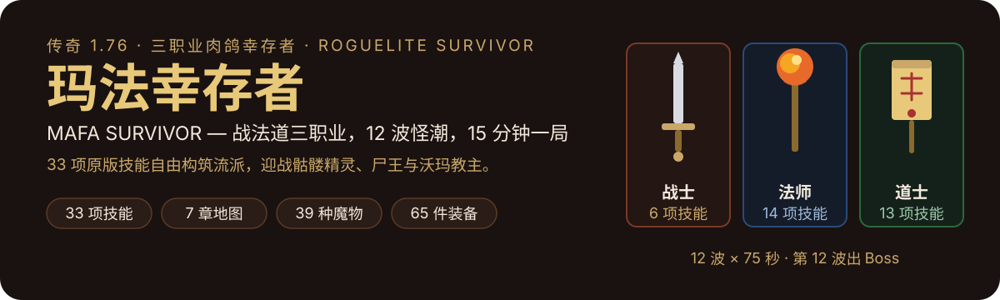
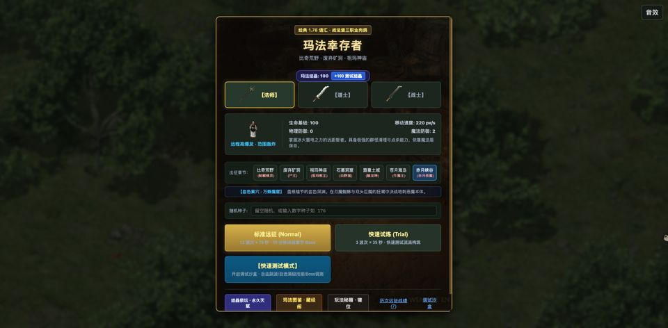
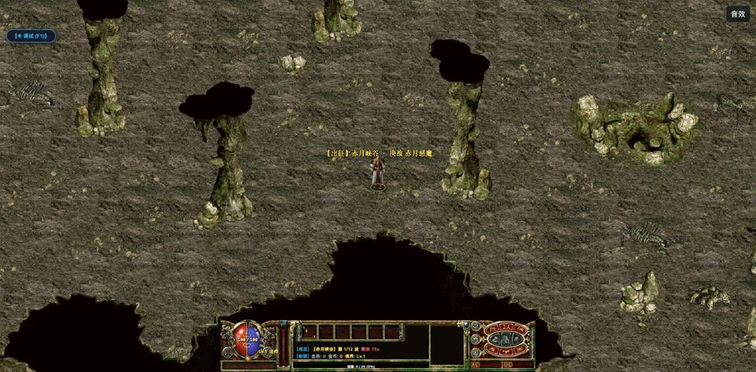

<p align="right"><a href="README.md">中文</a></p>

<p align="center">
  
</p>

<p align="center">
  <a href="https://xiaosang.cc/mafa-survivor-game/">Play Online</a>
  ·
  <a href="https://github.com/holynova/mafa-survivor-game">GitHub Repository</a>
</p>

Mafa Survivor is a standalone roguelite survivor game built on classic Legend of Mir 2 (1.76) mechanics: three classes — Warrior, Wizard, Taoist — 33 authentic skills to mix into builds, and 12 waves of monsters over 15 minutes, ending with legendary bosses like the Skeleton Spirit, Corpse King and Woma Lord. Built with React + Phaser 3, played on desktop.

## Screenshots

<p align="center">
  
  
</p>

## How to Play

- **Three classes**: Warrior melee swordsmanship (6 skills), Wizard elemental magic (14), Taoist talismans and summons (13), each with its own skill pool.
- **15 minutes a run**: 12 waves × 75 seconds each; a shop opens between waves (combat timer paused); the boss arrives in wave 12 — fail to kill it in time and the run ends.
- **Builds**: pick 1 of 3 upgrades on level-up to strengthen skills; 65 equipment pieces + 15 passive treasures + 6 set bonuses (虹魔 Rainbow Demon, 魔血 Blood Demon, 记忆 Memory, and the 祖玛 Zuma sets for all three classes), and skill evolutions (e.g. 冰咆哮 Ice Roar evolves into 暴风雪 Blizzard).
- **7 chapter maps**: 比奇荒野 (Bichon Wilderness), 废弃矿洞 (Abandoned Mine), 祖玛神庙 (Zuma Temple), 石墓洞窟 (Stone Tomb Cave), 盟重土城 (Mengzhong), 苍月海岛 (Cangyue Island), 赤月峡谷 (Red Moon Canyon), unlocked chapter by chapter.
- **39 monsters**: from Scarecrows and Hooked Cats to White Boars, the Venomous Dragon God, the Red Moon Demon and the Bull Demon King, all listed in the compendium.

## Run Locally

```bash
npm install
npm run dev
```

Tests (vitest, 13 test files):

```bash
npm test
```

## Tech

- React 19 (UI) + Phaser 3.90 (combat rendering) + TypeScript + Vite; deterministic randomness (Mulberry32 seed) makes any run reproducible.
- Data-driven: skills, equipment, monsters and wave budgets are all defined in `src/content.ts`; rules (damage, mitigation, stat caps) live in `src/rules.ts`.
- Saves use IndexedDB (`idb`) — reconnecting mid-run restores the run in progress; the full design document is `docs/GDD.md`.

```
src/App.tsx        UI: lobby / character select / shop / compendium / results
src/game.ts       Combat loop: waves, spawning, bosses, leveling
src/content.ts     Data tables: 33 skills / 65 equipment / 15 passives / 39 monsters / 7 chapters / 12 wave budgets
src/renderer.ts    Phaser rendering: characters, skill effects, shadows
src/rules.ts       Rules: damage, mitigation, stat soft/hard caps
src/audio.ts       Sound effects (classic Mir2-style audio)
src/save.ts        Saves: IndexedDB transactional writes
tests/             13 vitest test files
public/assets/mir/ Mir2-style asset pack (sprite sheets + sound effects)
docs/GDD.md        Full game design document
```

## Asset Credits

The in-game Mir2-style asset pack (sprite sheets and sound effects) is MIT-licensed, Copyright (c) 2026 Etorth — see `public/assets/mir/SOURCE_LICENSE.txt`. This repository declares no overall open-source license.
