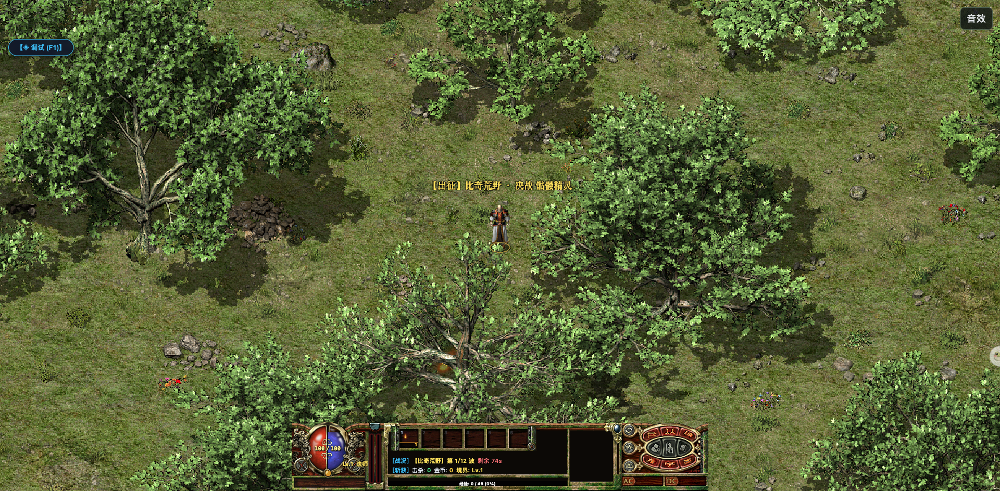

# Mafa Survivor / 玛法幸存者

基于经典《热血传奇》1.76 三职业（战法道）、33 项原版技能、装备特戒与魔物图鉴语汇的单机肉鸽幸存者游戏。玩家可自由构筑技能流派与被动宝物，在 15 分钟怪潮中迎战骷髅精灵、尸王与沃玛教主等经典 Boss。

A standalone roguelite survivor game built on classic Legend of Mir 2 (1.76) mechanics, featuring the holy trinity of Warrior, Wizard, and Taoist, 33 authentic skills, classic special rings and gear affixes. Build devastating spell combinations across 12 monster waves and defeat legendary chapter bosses.



## 在线体验 / Live Demo

- [Cloudflare Demo](https://xiaosang.cc/mafa-survivor-game/)
- [GitHub Repo](https://github.com/holynova/mafa-survivor-game)


## 本地运行 / Run locally

```bash
npm install
npm run dev
```

## 发布 / Deploy

```bash
npm run deploy
```

Cloudflare Workers · Route: `xiaosang.cc/mafa-survivor-game/*`

源码与部署配置使用同一个主分支；在本地手动发布，不创建 Cloudflare 专用分支或 GitHub Action。
