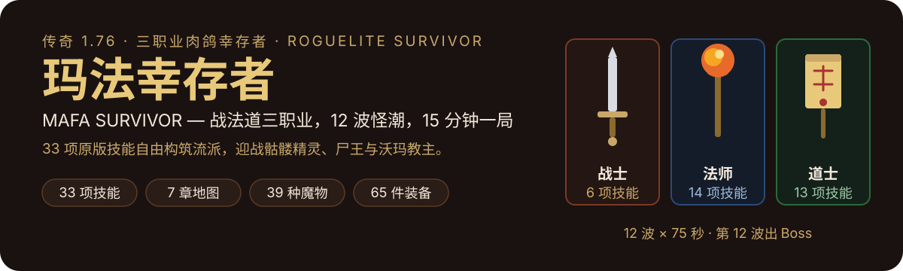
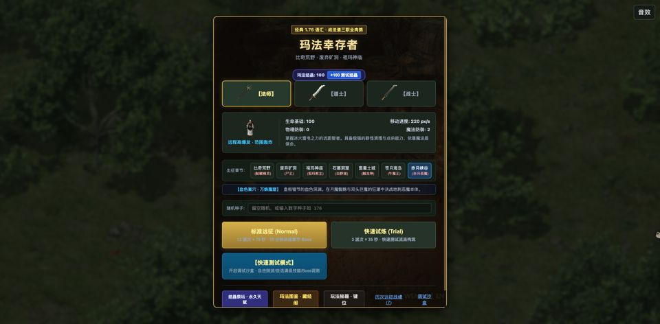
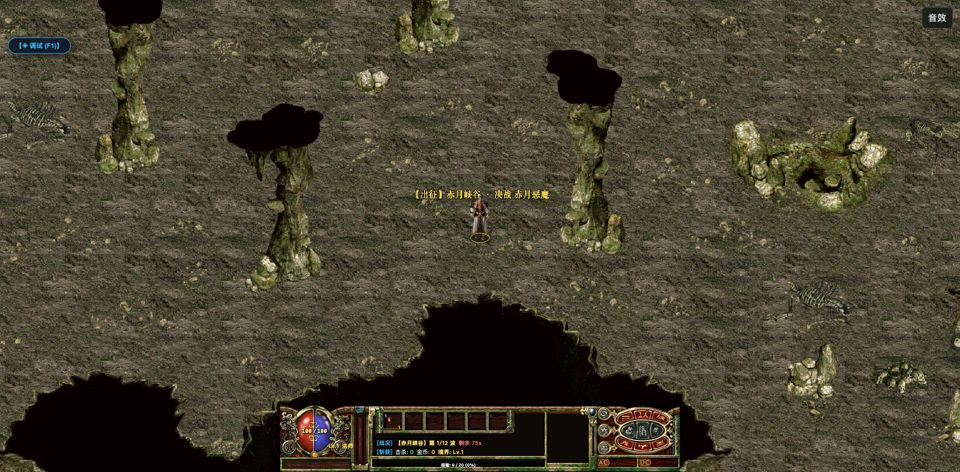

<p align="center">
  
</p>

<p align="center">
  <a href="https://xiaosang.cc/mafa-survivor-game/">在线玩 Play Online</a>
  ·
  <a href="https://github.com/holynova/mafa-survivor-game">GitHub 仓库</a>
</p>

玛法幸存者是一款基于经典《热血传奇》1.76 语汇的单机肉鸽幸存者游戏：战士、法师、道士三职业，33 项原版技能自由构筑流派与被动宝物，在 12 波、15 分钟的怪潮中迎战骷髅精灵、尸王、沃玛教主等经典 Boss。React + Phaser 3 驱动，桌面端游玩。

Mafa Survivor is a standalone roguelite survivor game built on classic Legend of Mir 2 (1.76) mechanics: three classes — Warrior, Wizard, Taoist — 33 authentic skills to mix into builds, and 12 waves of monsters over 15 minutes, ending with legendary bosses like the Skeleton Spirit, Corpse King and Woma Lord. Built with React + Phaser 3.

## 截图 / Screenshots

<p align="center">
  
  
</p>

## 玩法 / How to Play

- **三职业**：战士近战剑术（6 项技能）、法师元素魔法（14 项）、道士符箓召唤（13 项），各有专属技能池。
- **一局 15 分钟**：12 波 × 每波 75 秒；每波结束开商店（暂停战斗计时），第 12 波出 Boss，超时未击败即失败。
- **构筑**：升级三选一强化技能；65 件装备 + 15 件被动宝物 + 6 套套装效果（虹魔、魔血、记忆、祖玛三职业套），技能可进化（如冰咆哮进化为暴风雪）。
- **7 章地图**：比奇荒野、废弃矿洞、祖玛神庙、石墓洞窟、盟重土城、苍月海岛、赤月峡谷，逐章解锁。
- **39 种魔物**：从稻草人、多钩猫到白野猪、触龙神、赤月恶魔、牛魔王，图鉴可查。

## 本地运行 / Run Locally

```bash
npm install
npm run dev
```

测试（vitest，13 个测试文件）：

```bash
npm test
```

## 技术 / Tech

- React 19（界面）+ Phaser 3.90（战斗渲染）+ TypeScript + Vite；确定性随机（Mulberry32 种子）保证同一局可复现。
- 数据驱动：技能、装备、魔物、波次预算全部定义在 `src/content.ts`；规则（伤害、减免、属性上限）在 `src/rules.ts`。
- 存档用 IndexedDB（`idb`），断线重进可恢复进行中的一局；完整设计文档见 `docs/GDD.md`。

```
src/App.tsx        界面：大厅 / 选角 / 商店 / 图鉴 / 结算
src/game.ts       战斗主循环：波次、刷怪、Boss、升级
src/content.ts     数据表：33 技能 / 65 装备 / 15 被动 / 39 魔物 / 7 章节 / 12 波预算
src/renderer.ts    Phaser 渲染：角色、技能特效、阴影
src/rules.ts       规则：伤害、减免、属性软硬上限
src/audio.ts       音效（传奇原版风格音效）
src/save.ts        存档：IndexedDB 事务写入
tests/             13 个 vitest 测试文件
public/assets/mir/ 传奇风格素材包（精灵图集 + 音效）
docs/GDD.md        完整游戏设计文档
```

## English

**Mafa Survivor** is a standalone roguelite survivor game built on classic Legend of Mir 2 (1.76) mechanics.

- **Three classes**: Warrior (6 melee skills), Wizard (14 elemental spells), Taoist (13 talismans and summons), each with its own skill pool.
- **15 minutes a run**: 12 waves × 75 seconds; a shop opens between waves (combat timer paused); the boss arrives in wave 12 — fail to kill it in time and the run ends.
- **Builds**: pick 1 of 3 upgrades on level-up; 65 equipment pieces, 15 passive treasures, 6 set bonuses, and skill evolutions (e.g. Ice Roar evolves into Blizzard).
- **Content**: 7 chapters (Bichon Wilderness to Red Moon Canyon), 39 monsters from Scarecrows to the Red Moon Demon and Bull Demon King, with a full compendium.
- **Run it**: `npm install && npm run dev`. Tests: `npm test` (vitest, 13 test files).
- **Tech**: React 19 UI + Phaser 3.90 combat rendering + TypeScript + Vite; seeded deterministic RNG; data-driven content in `src/content.ts`; saves in IndexedDB.

## 素材来源 / Asset Credits

游戏内传奇风格素材包（精灵图集与音效）遵循 MIT 许可，Copyright (c) 2026 Etorth，见 `public/assets/mir/SOURCE_LICENSE.txt`。本仓库未声明整体开源协议。
